<!--
 * @Author: 度宝武 
 * @Date: 2026-11-14 08:23:18
 * @LastEditors: 哨兵电控 度宝武 2786573564@qq.com
 * @LastEditTime: 2026-11-15 17:43:10
 * @FilePath: \27-SPR-main (1)\27-SPR-main\08-VSCODE完整工作流\VSCODE本身功能了解.md
 * @Description: 
 * 
 * Copyright (c) 2026 by ${2786573564@qq.com}, All Rights Reserved. 
-->
# 常用的功能
##  顶部菜单栏的文件
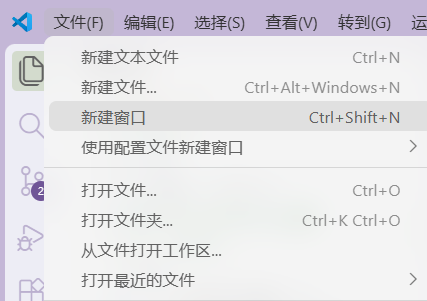

####  1.打开文件夹   点击你的项目（一个项目往往包含了多个文件和文件夹，且往往开发过程中，需要在不同文件中来回切换，所以选择到你的项目总目录地址打开即可）
####  2.打开最近的文件 往往有多个项目需要开发，总是点击找地址打开过于麻烦，点击打开最近的文件 即可
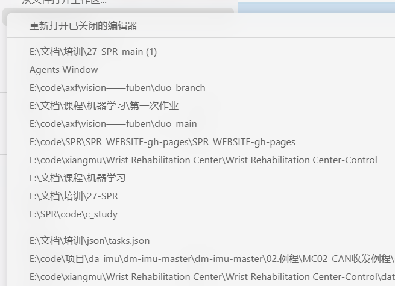

## 左侧的活动栏
#### 一般我们安装的插件的图标都会被设置到左侧的活动栏中，插件是VSCODE很强大的功能，根据不同的需求，下载不同的插件可以将你的VSCODE打造成一个很全面且强大的工具
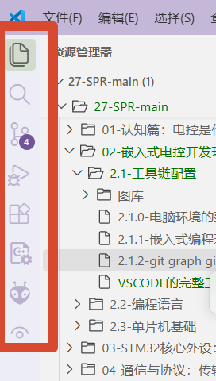

#### 1.资源管理器 查看你项目的文件排布和包含关系并进行跳转（人话：就你电脑的资源管理器 doge）但是这里包含了一个很关键的配置文件 工作区文件，用来帮助你来进行每个项目的管理和配置
#### 2.搜索 搜索一个变量或者一个函数（只要是你项目中存在的）都可以在这里搜索到位于哪个文件的哪个位置（当一个项目很臃肿或庞大或年久失修的时候你就会用到了）
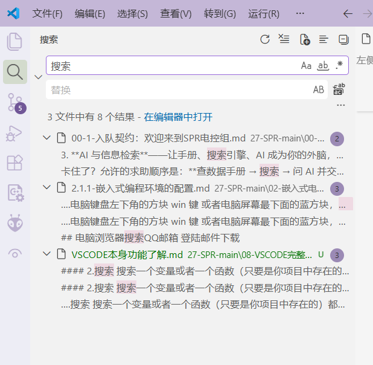

#### 3.源代码管理（重磅级务必掌握） 很直白，进行代码管理的文件（上传代码，回退代码，团队协作开发）
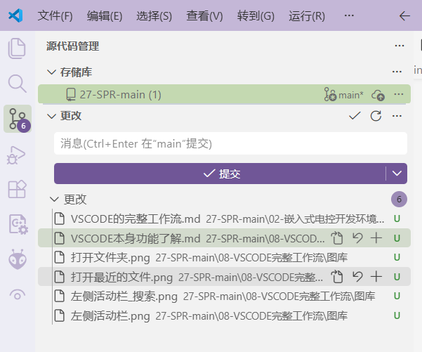

#### 4.运行和调试（重磅级务必掌握）烧录，调试，查看变量（简单点理解为Keil里面的debug）
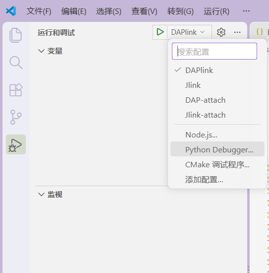

#### 5.1扩展（重要）根据需求进行对应插件的安装帮助扩展功能提升开发效率 
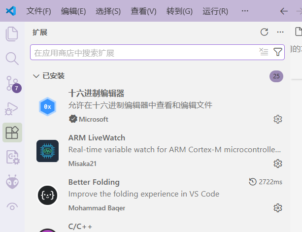

#### 5.2当扩展过多时，可以根据自己的需求进行选择左侧展示哪几个插件,在左侧的活动栏位置空白处右键勾选对应的插件即可
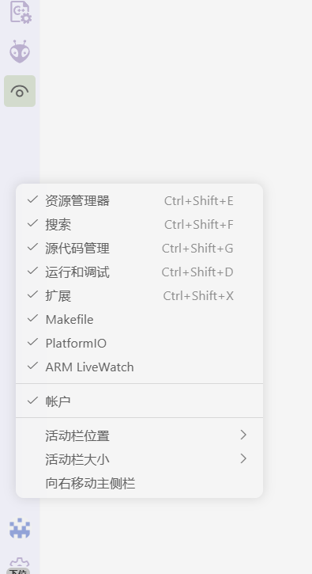

#### 5.3 显然随着学习的深入，会接触的不同领域的项目，这些项目往往需要搭配对应的插件，把这些插件混在一起会很乱（强迫症很难受），VSCODE的配置文件可以解决这个问题
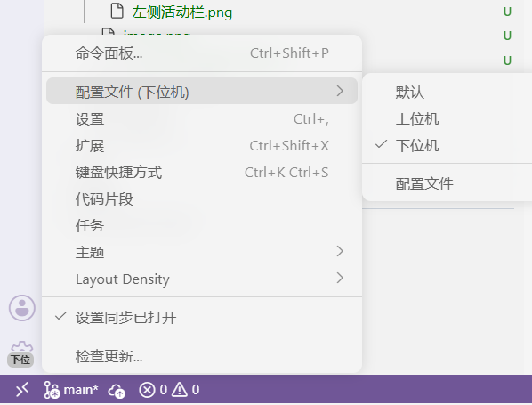

#### 我这里根据我自己的需要分成了三类（默认，上位机，下位机）；默认，就是一些基本的编程语言环境 C语言 PY语言加上AI来完成我的课程作业；上位机，就是在linux环境上加上ROS2进行嵌入式的控制并外加一些仿真，但windows用的不多，基本只远程连接目标电脑进行开发，或者隧道自己的WSL环境做轻量的开发工作;下位机就是针对单片机这一类的
### 5.4 具体配置
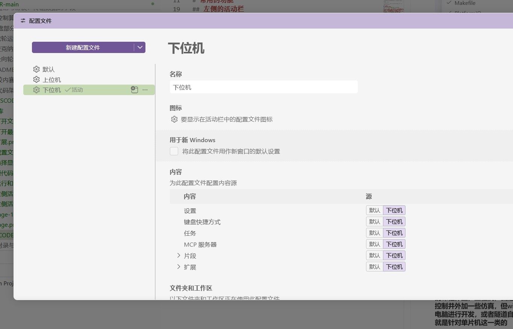

#### 点击新建配置文件，设置名称，选择复制配置文件来源，这里的复制就是为了方便，从一样的配置文件里复制过来一个模板然后在此基础上进行更改，内容的地方可自己进行灵活选择
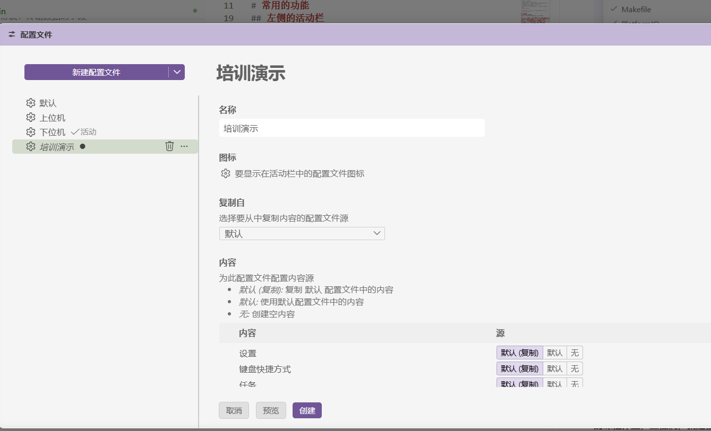
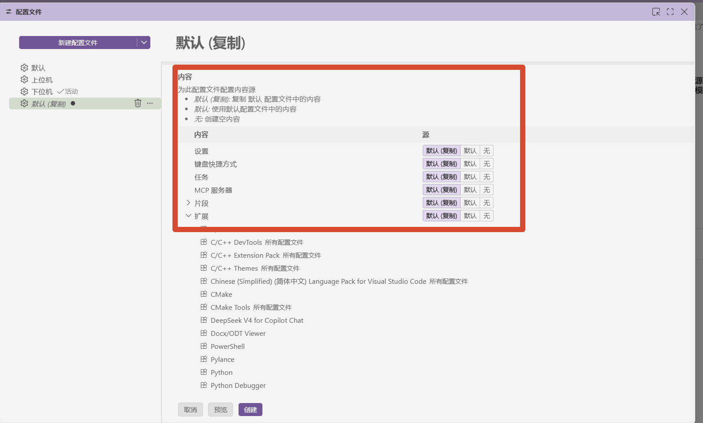

#### 6.设置，提升体验感的我觉得有必要修改的是两个（配置文件已经介绍过了，主题自己折腾吧，千人千面），一个是代码片段，一个是键盘快捷方式
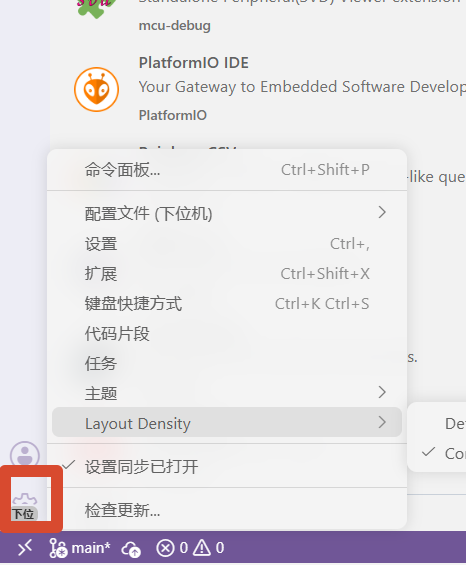

---
6.1    代码片段的作用就是将你常用的代码片段保存起来，在需要的时候直接插入，节省时间，emmmn这里主要的就是下位机的工作流里面的launch.json,tasks.json,工具链已经搭好之后，之后的每个项目只需要替换芯片的SVD库和项目的名称即可

---
6.2  键盘的快捷方式，就是快捷键来提升编程的效率（虽然是AI时代但是一些基础的快捷键也是很必要的），VSCODE默认配置的快捷键其实已经很权威了，但是个别的我觉得不太合适需要更换，其他的还是尽量保留，
#### 主要是 VSCODE 原生的快捷键   
复制（CTRL + C） 粘贴(CTRL +V )  
剪切 (CTRL +X)    选中当前行(CTRL + L)  
打开命令行（CTRL + SHIFT + P ）然后选择对应的命令  
常用命令  
重新载入窗口 Reload Window（装/卸载扩展、新装工具链后需要重载窗口才生效；它只是重开窗口，不等于重启VSCODE）
插入代码片段 Insert Snippet
#### 建议修改的按键 F3 转到定义  F4 返回上一处（VSCODE 默认是 F12 转到定义、Alt + ← 返回上一处）
因为调试的时候或者修改代码的时候，需要清楚数据的流转，就需要在一个一个函数中来回跳转/返回，鼠标点击很慢，配置快捷键就会很方便  
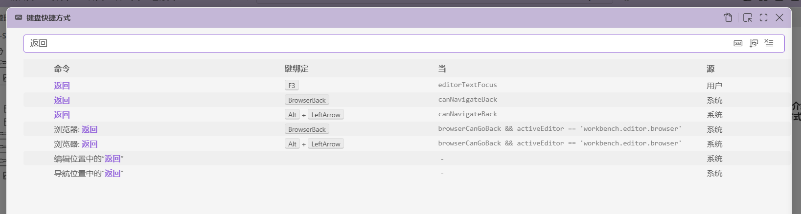  
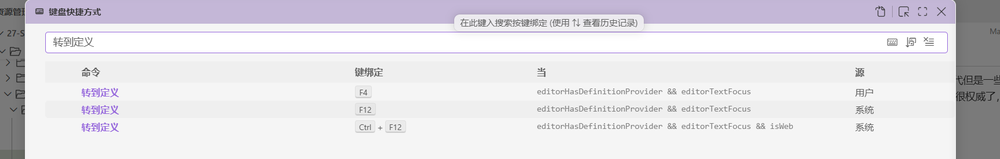

## 中间的编辑器
中间的就是日常写代码的没什么好介绍的，
1.右侧的缩略图是为了方便你来看到这个文件的总体布局以及点击对应红色的位置可以快速跳过去，而不用翻滚鼠标  
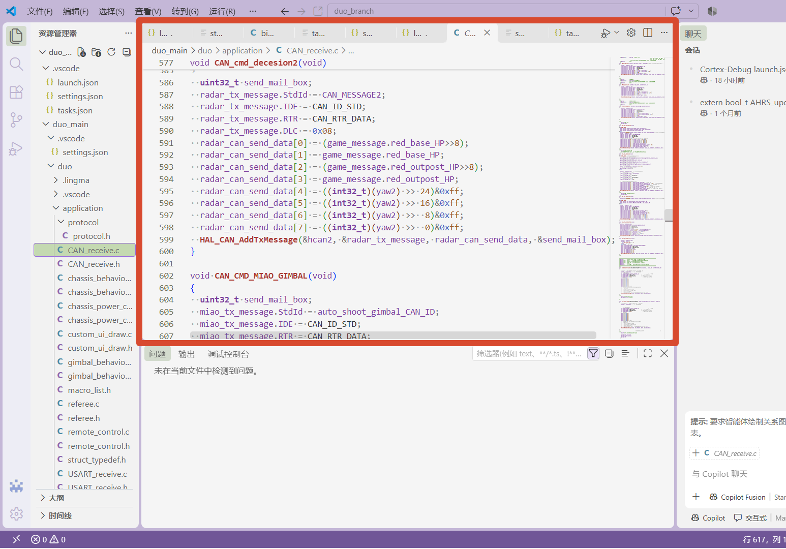  
2.向右拆分，主要是有时候你会需要频繁看两个或多个文件的内容，来回点击左侧的资源管理器会很抽象，（如果你健忘的话会是噩梦）   
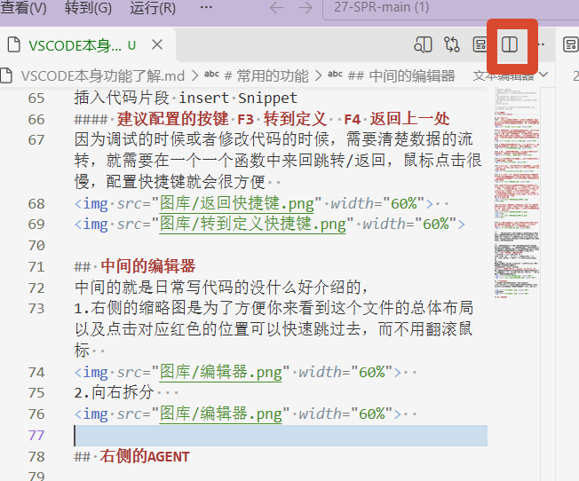  
也可以右键顶部空白处灵活选择  
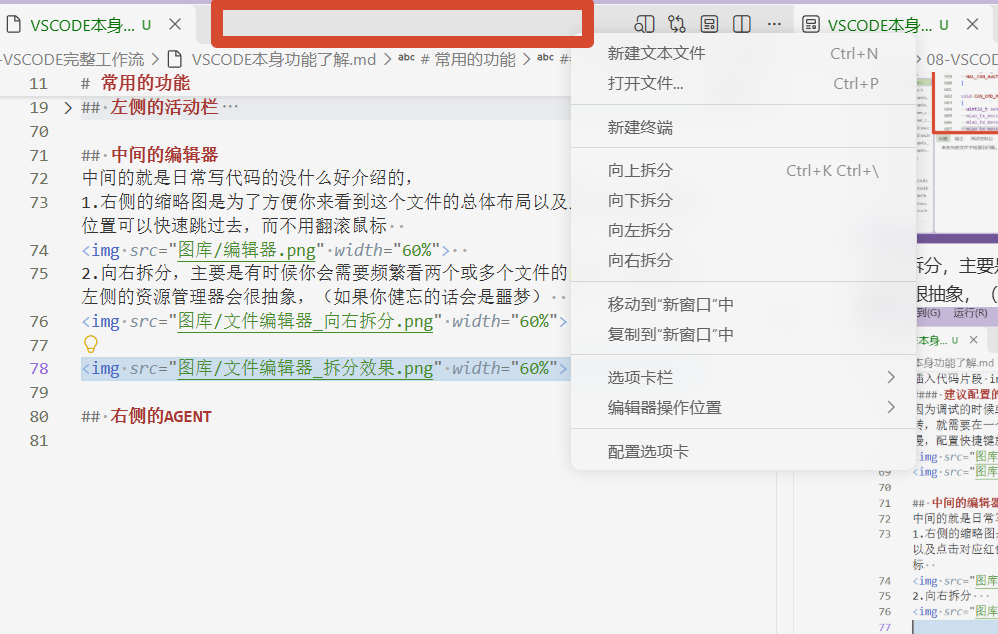  
效果如下  
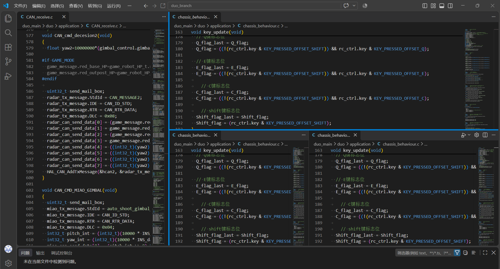  

## 右侧的AGENT
这是这个时代让人上瘾的功能，学会明智的使用会加快变强，一味的依赖只会表面上完成了任务，但是弱化自己的核心的学习分析能力，温水煮青蛙，被AI奴隶
当然简单的，繁杂的活，无意义的活，消磨时间的活，完全可以放手了，复杂的，涉及到区分控制工程师的核心能力的任务，AI辅助分析可以，帮助处理数据可以，但是，只是许愿式的去完成任务，只是空中楼阁、镜花水月  
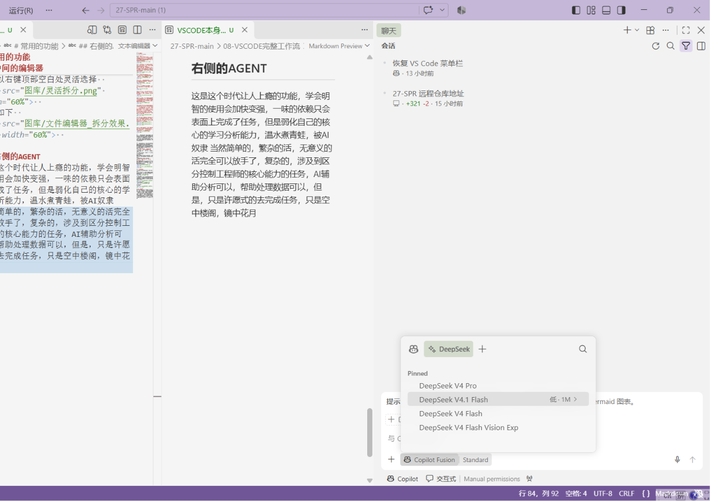  
至于这里的API设置，使用的是DEEPSEEK的API（其它的模型也可以），使用方法  
利用之前配置环境已经下载过的插件  
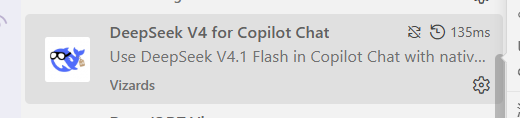  

然后打开命令行（ CTRL+shift+p）输入DEEPSEEK，选择设置APIKEY，粘贴你的DEEPSEEK模型的API密钥即可  
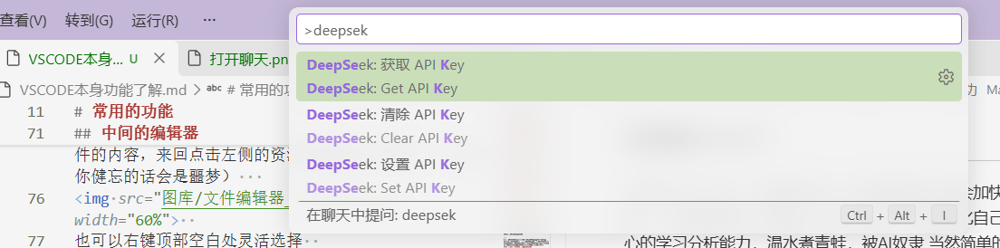  

当然AI时代的发展，VSCODE也与时俱进推出了新的工作模式，使用AI完成简单项目的同时如果想进行其他项目就要打开新窗口，需要网页预览就要跑到浏览器，显然这些很麻烦，AGENT模式你可以多线并行，在一个页面里面
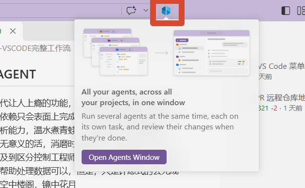  
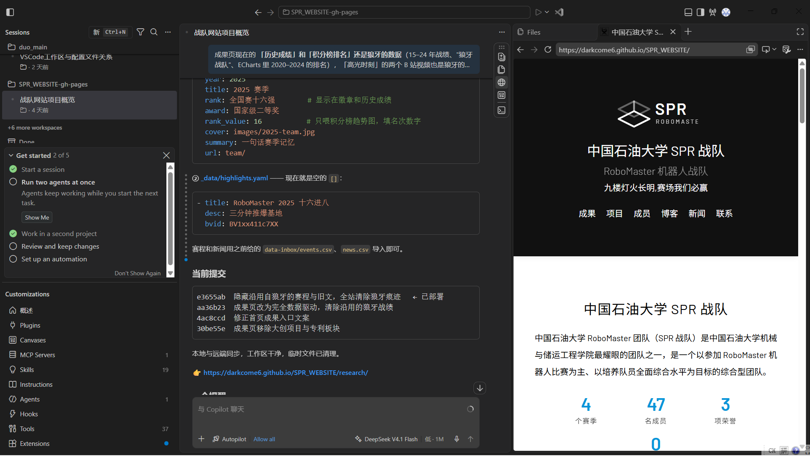  
